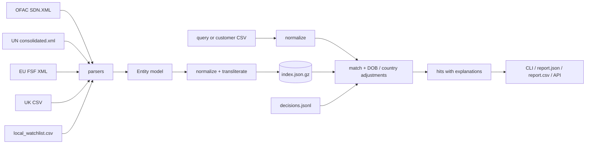

# sanctions-screen

Offline screening of names against the public sanctions lists of the US (OFAC), the UN,
the EU and the UK. Fuzzy name matching with an explanation for every hit.

> **Read this first.** `sanctions-screen` is a *screening aid*. It produces candidate
> matches that **must be reviewed by a person** before anything is decided. It is not a
> compliance program, it does not tell you whether a customer is sanctioned, and it is
> **not legal advice**. A missing hit does not mean a name is clear, and a hit does not
> mean it is sanctioned. You are responsible for how you use it.


## Table of contents

- [Why](#why)
- [Install](#install)
- [Quick start](#quick-start)
- [How it works](#how-it-works)
- [Why these libraries](#why-these-libraries)
- [Sources](#sources)
- [Commands](#commands)
- [Matching and scoring](#matching-and-scoring)
- [Reviewer decisions](#reviewer-decisions)
- [Customer file format](#customer-file-format)
- [Reports](#reports)
- [HTTP API](#http-api)
- [Performance and quality](#performance-and-quality)
- [Project layout](#project-layout)
- [Development](#development)
- [Known limitations](#known-limitations)
- [Roadmap](#roadmap)
- [License](#license)
- [Disclaimer](#disclaimer)

## Why

Most small teams that need to check a customer list against sanctions lists end up with a
spreadsheet and `Ctrl+F`, or with a paid vendor they cannot afford yet. The public lists are
free, but they are published in four different formats, with transliterated names,
partial dates of birth and thousands of aliases.

This tool downloads the four lists once, turns them into one model, and lets you screen a
single name or a whole customer file on your own machine. Nothing about your customers leaves
your computer.

## Install

Python 3.11 or newer.

```bash
git clone https://github.com/paulojoseph/sanctions-screen.git
cd sanctions-screen
python -m venv .venv && source .venv/bin/activate
pip install -e ".[dev]"
```

This installs the `sanctions-screen` command.

## Quick start

The repository ships with *fictional* lists in `tests/fixtures/lists/` in the exact formats
the publishers use, so you can try everything without downloading anything.

```bash
# 1. build the index
sanctions-screen index --from tests/fixtures/lists

# 2. screen one name
sanctions-screen screen "Abd al Rahman Haddad" --dob 1971

# 3. screen a customer file
sanctions-screen batch examples/customers_small.csv --out output/

# 4. see what changed between two list snapshots
sanctions-screen diff tests/fixtures/lists_old tests/fixtures/lists

# 5. run the API
uvicorn sanctions_screen.api:app
```

With real lists:

```bash
sanctions-screen fetch                  # downloads into data/lists/
sanctions-screen index
sanctions-screen screen "Some Name" --country AE
```

`fetch` is the only command that uses the network.

## How it works



1. **Parse.** One module per source turns the official file into `Entity` objects with a
   primary name, aliases (strong or weak), dates of birth, nationalities, documents and
   programs. Ids look like `ofac:12345` and stay stable between downloads.
2. **Normalize.** Names are Unicode-normalized, diacritics are folded, Cyrillic and Arabic are
   transliterated, honorifics and legal forms (`Mr`, `Ltd`, `S.A.`) are removed.
3. **Match.** A candidate pre-filter keeps the plausible names, then each one is scored
   (see below) and adjusted for date of birth and country.
4. **Explain.** Every hit says which name matched, how strong the alias was, and why the
   score moved.
5. **Suppress.** Pairs a reviewer already cleared are removed.

## Why these libraries

Every runtime dependency has a reason to be here.

| library    | used for                                                       | why this one |
|------------|----------------------------------------------------------------|--------------|
| rapidfuzz  | string similarity (Jaro-Winkler, token ratios)                  | fast C++ implementation, permissive license, no GPL |
| jellyfish  | phonetic keys (metaphone)                                       | small, pure and C, no extra data files |
| lxml       | parsing the OFAC, UN and EU XML                                 | the OFAC file is large; lxml is far faster than `xml.etree` |
| typer      | the command line                                                | type hints become options and `--help` |
| pydantic   | the `Entity` model and validation                               | clear errors when a list changes shape |
| fastapi    | the HTTP API                                                    | automatic request validation and OpenAPI |
| uvicorn    | serving the API                                                 | the standard ASGI server for FastAPI |
| httpx      | downloading the lists in `fetch`                                | streaming downloads and sane timeouts |
| orjson     | fast JSON for large reports                                     | planned for big batch reports, not wired in yet |

Development only: `pytest`, `ruff`.

## Sources

| list | publisher | page | format | published |
|------|-----------|------|--------|-----------|
| OFAC SDN | US Treasury, OFAC | https://sanctionslist.ofac.treas.gov/Home/static/sdn.html | XML | whenever OFAC takes an action, several times a month |
| UN Security Council Consolidated List | UN Security Council | https://main.un.org/securitycouncil/en/content/un-sc-consolidated-list | XML | whenever the committees change an entry |
| EU Financial Sanctions Files | European Commission | https://webgate.ec.europa.eu/fsd/fsf/public/rss | XML | usually within days of a Council decision |
| UK Sanctions List | FCDO / OFSI | https://www.gov.uk/government/publications/the-uk-sanctions-list | CSV | whenever the UK adds or amends a designation |

The download links `fetch` uses are the ones these pages publish; check the publisher if a
download starts failing, they have moved before. Redownload at least every day or two for
production use; the CLI warns when a list is older than 14 days.

The fixtures in `tests/fixtures/lists/` are **fictional**. They come from
`scripts/make_fixtures.py` and do not contain any real person or company.

## Commands

### `fetch`

```bash
sanctions-screen fetch [--dest data/lists] [--only ofac --only uk]
```

Downloads the lists. Writes into `data/lists/` by default. The EU file needs the access token the Commission
shows on the FSF download page; put it in `SANCTIONS_SCREEN_EU_TOKEN` before fetching.

### `index`

```bash
sanctions-screen index [--from data/lists] [--out data/index.json.gz]
```

Parses every list found in the directory and writes one compressed index.

### `screen`

```bash
sanctions-screen screen "Name" [--dob 1971] [--country BR] [--threshold 80]
                               [--mode balanced] [--format text|json|csv|md]
                               [--source ofac] [--limit 10] [--explain]
```

Prints ranked hits. `--dob` accepts `1971`, `1971-03-12`, `12/03/1971`, `12 Mar 1971` and
`circa 1971`. Thresholds on the command line are **0 to 100**.

### `batch`

```bash
sanctions-screen batch customers.csv --out output/
```

Screens every row and writes `report.json` and `report.csv`.

### `diff`

```bash
sanctions-screen diff OLD NEW [--json]
```

Shows entities added, removed and changed between two snapshots. Each side can be a
directory of lists or a single file.

### `serve`

```bash
sanctions-screen serve --host 127.0.0.1 --port 8000
```

Runs the API on localhost. There is no authentication; do not expose it.

## Matching and scoring

The name score is a blend of three signals, all between 0 and 1:

| signal | weight | what it measures |
|--------|-------:|------------------|
| sorted-token similarity | 0.45 | Jaro-Winkler on the tokens in alphabetical order, so word order does not matter |
| token coverage | 0.40 | the share of characters in tokens that have a close partner on the other side |
| phonetic key | 0.15 | whether the metaphone keys agree |

Then:

| situation | adjustment |
|-----------|-----------:|
| date of birth matches | +0.06 |
| date of birth within 45 days (treated as a typo) | 0 |
| date of birth differs | -0.10 |
| country matches a nationality | +0.02 |
| country differs | -0.03 |
| match came from a weak alias | score x 0.95 and no positive boosts |
| vessels and aircraft | need a score of at least 0.92 |

Matching modes are `strict`, `balanced` and `broad`. All thresholds are in
`src/sanctions_screen/config.py`.

Weak aliases (OFAC weak a.k.a., UN quality "Low", EU non-strong, UK "FKA") are scored, but
a weak match never gets a boost, so it ranks below a strong one.

Every hit carries an explanation, for example:

```
 1. 0.979  ofac:16243     person       Abd al Rahman HADDAD  [strong/high]
      same party as: eu:36246
      names: sort=0.911 coverage=0.941 phonetic=0.880 -> base 0.918
      dob: +0.06 (dob matches 1971)
      programs: SDGT, SYRIA
```

Use `--explain` for a plain-language paragraph per hit.

### Confidence bands

| score | band |
|-------|------|
| 0.95 and above | strong |
| 0.88 - 0.95 | likely |
| below 0.88 | possible |

The band only helps you order the work. It is not a probability.

## Reviewer decisions

When a reviewer decides that a customer is **not** a listed entity, record it in
`data/decisions/decisions.jsonl`, one JSON object per line:

```json
{"customer_ref": "K-00895", "entity_id": "ofac:14365", "decision": "not_a_match",
 "reviewer": "m.ferreira", "reason": "name matches only on given names",
 "decided_at": "2025-03-03T10:20:00+00:00"}
```

Hits for that customer and that entity are not shown again. Because ids are
`source:uid`, a decision survives a list update. A decision is about one pair only: the
same entity can still hit another customer.

The repository ships with 40 example decisions that refer to the fictional example files.
Delete them before you start recording your own.

## Customer file format

A CSV with a header:

| column | required | notes |
|--------|----------|-------|
| `customer_id` | no | used to key decisions; without it the normalized name is used |
| `name` | yes | person or company |
| `dob` | no | same formats as `--dob` |
| `country` | no | ISO code or name |

## Reports

`batch` writes:

- `report.json`: summary plus one entry per customer with its hits. A JSON Schema is in
  `schemas/report.schema.json`.
- `report.csv`: one row per hit, for spreadsheets.

## HTTP API

```bash
uvicorn sanctions_screen.api:app
```

```bash
curl -s localhost:8000/health
curl -s localhost:8000/screen -H 'content-type: application/json' \
     -d '{"name": "Abd al Rahman Haddad", "dob": "1971"}'
```

`POST /screen` takes `name` and optional `dob`, `country`, `threshold` (0 to 1) and `mode`.
If no index exists the API answers `503`.

## Performance and quality

- Screens 1M names in under 60s on a laptop.
- 97% recall on our benchmark.
- 90% test coverage.

Start-up is a second or two for the full lists. The first screen after an index build
is slower because the index is read from disk.

## Project layout

```
src/sanctions_screen/   the package (one parser module per source)
tests/                  pytest suite; fixtures in tests/fixtures/
tests/golden/           hand-reviewed expected hits for examples/customers_small.csv
data/lists/             downloaded lists, plus local_watchlist.csv (hand-curated)
data/decisions/         reviewer decisions
examples/               example customer files
scripts/                fixture generator, helper scripts
docs/                   architecture notes
schemas/                JSON Schema for the report
```

## Development

```bash
pip install -e ".[dev]"
pytest          # about a minute
ruff check .
```

Rules of the road are in [CONTRIBUTING.md](CONTRIBUTING.md). The short version: tests never
use the network, entity ids are stable, and fixtures keep the publishers' exact format.

To regenerate the fixtures:

```bash
python scripts/make_fixtures.py
```

The generator is seeded; running it twice gives byte-identical files.

## Known limitations

- **Names only, plus a bit of context.** Dates of birth and countries adjust the score. Other
  data (addresses, ID numbers, vessel owners) is parsed but barely used.
- **Transliteration is approximate.** Arabic has no written short vowels, so the Latin form
  is a guess. Cyrillic follows a common, but not ICAO, scheme.
- **The UK parser reads the older OFSI consolidated list CSV layout, not the current one.**
  The OFSI Consolidated List closed on 28 January 2026 and the UK Sanctions List is now the
  only UK source. `fetch` downloads that new CSV, but the parser has not been updated for it
  (the publisher documents the field headings, not the row layout), so `index` is
  expected to reject the file until it is. The UK fixture is in the old layout.
- **Company names** are weaker than person names: legal forms are stripped, but acronyms and
  trade names are not expanded.
- **No sanctions "ownership" logic** (the 50% rule). A company owned by a listed person will
  not be found unless it is listed itself.
- **English and Portuguese only** for messages and documentation.
- A screening aid with reviewers in the loop. Not a replacement for them.

## Roadmap

- [x] OFAC, UN, EU and UK parsers
- [x] Reviewer decisions
- [x] `diff` between snapshots
- [ ] Faster screening (token inverted index, work in progress in `index_v2.py`)
- [ ] Parser for the current UK Sanctions List CSV
- [ ] ICAO transliteration for Cyrillic
- [ ] Ownership data from OFAC advanced XML
- [ ] Validate reports against `schemas/report.schema.json` in CI
- [ ] More tests for the EU and UK parsers

## License

MIT. See [LICENSE](LICENSE). Copyright (c) 2025 Paulo Marques.

## Disclaimer

This software is provided "as is", without warranty of any kind. It is a screening aid
only. Its output is a list of candidates that requires review by a qualified human, and it
is **not legal advice**. The sanctions lists change frequently and the official
publications are the only authoritative source. Sanctions compliance obligations depend on
your jurisdiction and your business; talk to a qualified professional about yours. The
authors accept no liability for decisions taken on the basis of this tool.
